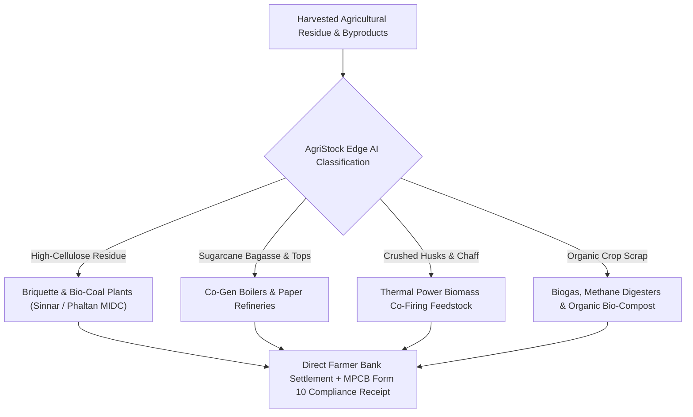
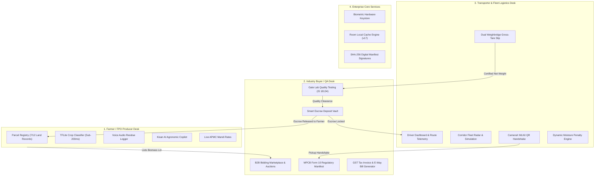
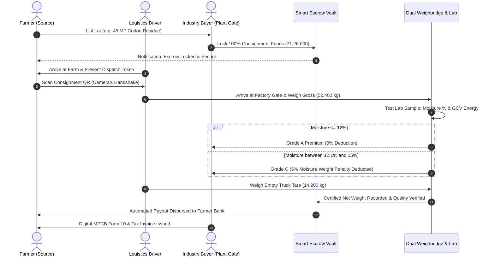

# 🌾 AgriStock (WasteTrack) • Team AstraNyx

[](https://www.coephaltan.edu.in/hackathon2k26.html)
[](https://www.coephaltan.edu.in/hackathon2k26.html)
[-DC2626?style=for-the-badge)](https://www.coephaltan.edu.in)
[-3DDC84?style=for-the-badge&logo=android&logoColor=white)](https://developer.android.com/)
[](https://kotlinlang.org/)
[](https://developer.android.com/jetpack/compose)
[](#-system-architecture--clean-data-pipeline)
[](#-mpcb-form-10-statutory-compliance--gst-manifests)

> 🌾 **AgriStock** is a multi-sided circular agritech operating system and digital biomass marketplace developed for **PESCOE · Hackathon 2K26** (Phaltan Education Society's College of Engineering, Phaltan). It connects rural farmers, industrial bio-refineries, logistics transporters, and regulatory boards across Maharashtra's agrarian belts (Satara, Phaltan, Nashik, Sinnar, Niphad) to eradicate open-field stubble burning, streamline statutory MPCB Form 10 manifests, enforce dual-weighbridge anti-fraud verification, and protect farmer payments via automated Smart Escrow contracts.

---

## 📑 Table of Contents

1. [Executive Summary & Problem Landscape](#-executive-summary--problem-landscape)
2. [Circular Agronomy Vision: "Someone's Waste is Someone's Diamond"](#-circular-agronomy-vision-someones-waste-is-someones-diamond)
3. [The 4-Persona Architecture & System Workflows](#-the-4-persona-architecture--system-workflows)
4. [Role & Contributor Distribution Matrix (Team AstraNyx)](#-role--contributor-distribution-matrix-team-astranyx)
5. [3-Way Handshake Anti-Fraud Dispatch & Weighbridge Verification](#-3-way-handshake-anti-fraud-dispatch--weighbridge-verification)
6. [Gate Lab Biomass Quality & Moisture Deduction Engine (IS 18134)](#-gate-lab-biomass-quality--moisture-deduction-engine-is-18134)
7. [MPCB Form 10 Statutory Compliance & GST Manifests](#-mpcb-form-10-statutory-compliance--gst-manifests)
8. [Edge AI Computer Vision & Kisan Conversational Copilot](#-edge-ai-computer-vision--kisan-conversational-copilot)
9. [Farmland Parcel Registry & 7/12 Land Records](#-farmland-parcel-registry--712-land-records)
10. [System Architecture & Clean Data Pipeline](#-system-architecture--clean-data-pipeline)
11. [Technology Stack & Core Libraries](#-technology-stack--core-libraries)
12. [Verification & Build Instructions](#-verification--build-instructions)
13. [Hackathon Submission & Acknowledgements](#-hackathon-submission--acknowledgements)

---

## 🌾 Executive Summary & Problem Landscape

In Maharashtra's agricultural corridors—from the sugarcane and dairy belts of **Phaltan & Satara** to the cotton, onion, and grape plains of **Nashik & Ahmednagar**—over **28 Million Metric Tonnes** of crop residue and agro-industrial biomass are generated annually:

```
┌────────────────────────────────────────┐        ┌────────────────────────────────────────┐
│      Rural Agriculture Challenges      │        │       Ecological & Economic Loss       │
├────────────────────────────────────────┤        ├────────────────────────────────────────┤
│ • Stubble burning & seasonal ruin      │  ───►  │ • 142 MT CO₂e wasted per 100 MT        │
│ • Local middleman cartel price-locking │        │ • ₹15,000 / Acre NGT & MPCB fines      │
│ • Transit ballast & weighbridge fraud  │        │ • Acute boiler fuel deficits in plants │
│ • Regulatory paperwork bottlenecks     │        │ • Buyer payment defaults on farmers    │
└────────────────────────────────────────┘        └────────────────────────────────────────┘
```

1. **Open-Air Stubble Burning**: Post-harvest cotton stalks, wheat chaff, and uncrushed bagasse are burned in fields due to prohibitive collection and transport costs, causing severe air pollution and attracting penalties up to ₹15,000 per acre under the *Air (Prevention & Control of Pollution) Act*.
2. **Industrial Supply Deficit**: Thermal power boilers, paper mills, and briquette manufacturers in MIDC corridors urgently need standardized agricultural biomass to satisfy the **Ministry of New and Renewable Energy (MNRE)** 5% to 7% biomass co-firing mandate.
3. **Logistics & Quality Disputes**: Dispatched biomass consignments frequently suffer from moisture-laden weight manipulation, unverified weighbridge slips, and high silica contamination.
4. **Payment Insecurity**: Smallholder farmers fear non-payment or delayed disbursements from corporate buyers.

**AgriStock** resolves these challenges by introducing an end-to-end, verified transactional ecosystem powered by on-device computer vision, automated escrow settlements, dual weighbridge validation, and statutory compliance automation.

---

## ♻️ Circular Agronomy Vision: "Someone's Waste is Someone's Diamond"

Agricultural byproducts possess high commercial value when connected to the appropriate industrial conversion stream:



* **Cotton Stalk Residue (Nashik/Sinnar)**: Gross Calorific Value (GCV) $\ge 3,900\text{ kcal/kg}$, replacing imported Indonesian steam coal.
* **Sugarcane Bagasse (Phaltan/Satara)**: High-fiber biomass for co-generation boilers and biodegradable packaging.
* **Soybean Chaff & Wheat Straw**: Raw substrate for compressed biomass briquettes, animal fodder pellets, and bio-fertilizer.

---

## 👥 The 4-Persona Architecture & System Workflows

AgriStock enforces strict separation of concerns across 4 distinct operational personas:



---

## 🏆 Role & Contributor Distribution Matrix (Team AstraNyx)

AgriStock was built by **Team AstraNyx** adhering to professional engineering practices, clean code conventions, domain-driven package structuring, and GitFlow pull request workflows:

| Contributor | Engineering Role | GitHub Profile | Core Shipped Modules & Responsibilities |
|:---|:---|:---|:---|
| **Sumit Borase** | Team Lead / System Architect | [`@sumitborse63`](https://github.com/sumitborse63) | • System Architecture, Material 3 Theme & NavGraph<br>• Biometric Authentication & Session Keystore<br>• Farmer Dashboard & Crop Cycle Management<br>• TensorFlow Lite MobileNet Residue Classifier<br>• Farmland Parcel Registry & 7/12 Survey Tracker<br>• Kisan Conversational AI Assistant & Agronomic Copilot |
| **Kasturi Shinde** | Industry Buyer & Compliance Lead | [`@KasturiShinde03`](https://github.com/KasturiShinde03) | • Industrial Buyer & Recycler Console<br>• B2B Bidding Marketplace & Auction Procurement Desk<br>• Smart Contract Escrow Order Vault<br>• MPCB Hazardous/Bio-waste Form 10 Compliance Engine<br>• GST Biomass Tax Invoice & Gatepass Manifest Exporter<br>• Gate Lab Biomass Quality (IS 18134 GCV) & Moisture Audit |
| **Harshita Thakur** | Transporter & Fleet Logistics Lead | [`@Harsita-thakur`](https://github.com/Harsita-thakur) | • Transporter & Driver Telemetry Dashboard<br>• Corridor Fleet Radar & Real-Time Route Simulation<br>• CameraX ML Kit Optical QR Handshake Scanner<br>• Dual Weighbridge Gross-Tare Slip Generator<br>• Moisture Content Deduction Engine ($>12\%$ threshold) |
| **Harshal Suryawanshi** | AI, Speech & Onboarding Specialist | [`@harshal385`](https://github.com/harshal385) | • Multilingual Voice Residue Audio Logger<br>• Production Onboarding Carousel with Custom Agricultural Photography<br>• Regional Dialect Integration & Illiterate Accessibility |

---

## 🤝 3-Way Handshake Anti-Fraud Dispatch & Weighbridge Verification

To eliminate transit theft, scrap ballast padding, and phantom drop-offs:



---

## 🔬 Gate Lab Biomass Quality & Moisture Deduction Engine (IS 18134)

When biomass consignments reach the factory gate, the buyer conducts sample proximate analysis before releasing escrow funds:

* **Gross Calorific Value (GCV)**: Bomb-calorimetry energy rating measured in `kcal/kg` (Standard: 3,400 – 4,400 kcal/kg).
* **Moisture Content Analyzer**: Real-time deduction algorithm:
  * **$\le 12.0\%$ (Grade A Premium)**: 0% penalty, full payout released.
  * **$12.1\% \text{ to } 14.0\%$ (Grade B Standard)**: 2% moisture adjustment.
  * **$14.1\% \text{ to } 16.0\%$ (Grade C Penalty)**: 5% weight deduction applied to escrow payout.
  * **$> 16.0\%$ or Ash $> 8.0\%$**: Consignment rejected to protect industrial boilers from clinkering.
* **Digital Audit Stamp**: Every certificate is sealed with a unique SHA-256 cryptographic digest.

---

## 📜 MPCB Form 10 Statutory Compliance & GST Manifests

* **Maharashtra Pollution Control Board (MPCB) Form 10 Manifest**: Automatically generates legally required transit manifests under the *Hazardous & Other Wastes (Management & Transboundary Movement) Rules*.
* **HSN Code Tax Mapping**:
  * **HSN 1213**: Cereal straw and husks, unprepared.
  * **HSN 1404**: Vegetable materials used primarily as biomass fuel.
  * **HSN 2308**: Sugarcane bagasse and agro-industrial waste.
* **Vector PDF Engine**: Renders print-ready A4 regulatory certificates and E-Way bill receipts natively using Android `PdfDocument`.

---

## 🤖 Edge AI Computer Vision & Kisan Conversational Copilot

### 1. Multi-Modal Edge AI Scanner (`CropClassifier.kt`)
* **Sub-200ms Inference**: Runs completely offline on low-cost Android field hardware using quantized TensorFlow Lite models.
* **Automated Waste Segregation**: Distinguishes dry fibrous biomass from wet organic spoilage and calculates degradation index and shelf life.

### 2. Kisan AI Agronomic Copilot (`AgentScreen.kt` & `AgentViewModel.kt`)
* Embedded agronomic intelligence answering farmer questions:
  * Daily APMC mandi rates across Nashik, Sinnar, and Phaltan markets.
  * MPCB and NGT open burning legal penalties and alternative subsidies.
  * Field sun-drying schedules to achieve $\le 12\%$ moisture threshold.
  * Pink bollworm eradication protocols via post-harvest stalk shredding.

---

## 🗺️ Farmland Parcel Registry & 7/12 Land Records

* **Cadastral Farm Parcel Mapping**: Registers agricultural parcels with Gat Numbers, Survey Numbers, and GPS polygon coordinates.
* **7/12 Maharashtra Land Record Integration**: Validates land ownership, crop cultivation history, and legal non-burning compliance affidavits.

---

## 🏗️ System Architecture & Clean Data Pipeline

```
┌─────────────────────────────────────────────────────────────────┐
│                      Presentation Layer                         │
│   Jetpack Compose UI • Material 3 Theming • CameraX & Voice     │
│                            │                                    │
│                     StateFlow / State                           │
│                            ▼                                    │
│                 Architecture ViewModels                         │
│   (FarmerDashboardVM, RecyclerVM, DriverVM, AgentVM, etc.)      │
└────────────────────────────┬────────────────────────────────────┘
                             │
┌────────────────────────────▼────────────────────────────────────┐
│                        Domain Layer                             │
│   Domain Models: CropCycle, Farm, Listing, Order, BiomassReport │
│   Repository Interfaces: IAuthRepo, ICropRepo, IMarketRepo      │
└────────────────────────────┬────────────────────────────────────┘
                             │
┌────────────────────────────▼────────────────────────────────────┐
│                         Data Layer                              │
│   Room Local SQLite DB (v17) ──► WorkManager Background Sync    │
│   TFLite Neural Classifier   ──► ML Kit Optical Barcode Scanner │
│   AndroidX Biometric Keystore──► Native PDF Vector Exporter     │
└─────────────────────────────────────────────────────────────────┘
```

---

## 🛠️ Technology Stack & Core Libraries

| Component | Technology | Version | Purpose |
|:---|:---|:---|:---|
| **Language** | Kotlin | `2.0.0` | Modern, type-safe Android development |
| **UI Framework** | Jetpack Compose (BOM) | `2024.02.00` | Declarative UI with Material Design 3 |
| **Architecture** | Clean + MVI/MVVM | — | Unidirectional data flow with StateFlow |
| **Dependency Injection** | Dagger Hilt | `2.51` | Compile-time dependency injection |
| **Local Database** | Room Database | `2.6.1` | Offline-first relational cache |
| **Edge AI & Vision** | TensorFlow Lite & ML Kit | `2.16.1` / `17.0.9` | On-device crop recognition & QR decoding |
| **Camera Pipeline** | AndroidX CameraX | `1.3.1` | Hardware-accelerated camera preview |
| **Biometric Security** | AndroidX Biometric | `1.1.0` | Fingerprint and Face Unlock keystore |
| **PDF Generation** | Android Native `PdfDocument` | Built-in | Vector A4 GST invoices & MPCB Form 10 |

---

## 🚀 Verification & Build Instructions

### Prerequisites
* **Android Studio:** Iguana (2023.2.1) / Jellyfish or newer
* **Java Development Kit:** JDK 17
* **Android SDK:** Compile SDK 34, Min SDK 24, Target SDK 34

### Compilation & Installation

```bash
# 1. Clone the repository
git clone https://github.com/college-hack24-nov26/hack-astranyx.git
cd hack-astranyx

# 2. Verify compilation with Kotlin compiler & KSP
./gradlew compileDebugKotlin

# 3. Assemble debug APK
./gradlew assembleDebug

# 4. Install on connected Android device or AVD
adb install app/build/outputs/apk/debug/app-debug.apk
```

---

## 🏅 Hackathon Submission & Acknowledgements

* **Hackathon:** [**PESCOE · Hackathon 2K26**](https://www.coephaltan.edu.in/hackathon2k26.html)
* **Organized By:** **Phaltan Education Society's College of Engineering, Phaltan (PESCOE)**
* **Affiliation:** Dr. Babasaheb Ambedkar Technological University (DBATU), Lonere
* **Strategic Associations:** Cummins India Foundation & Govind Milk and Milk Products
* **Team Name:** **Team AstraNyx**
* **Institution:** K. K. Wagh Institute of Engineering Education & Research, Nashik (Savitribai Phule Pune University)
* **Target Agricultural Corridors:** Satara-Phaltan Sugar Belt, Nashik-Sinnar Cotton & Onion Cluster, Niphad Bio-Energy Basin
* **License:** Apache License 2.0

---

<div align="center">
  <sub>Built with ❤️ by Team AstraNyx for PESCOE Hackathon 2K26 — Catalyzing circular bio-economy and clean air across Maharashtra.</sub>
</div>
