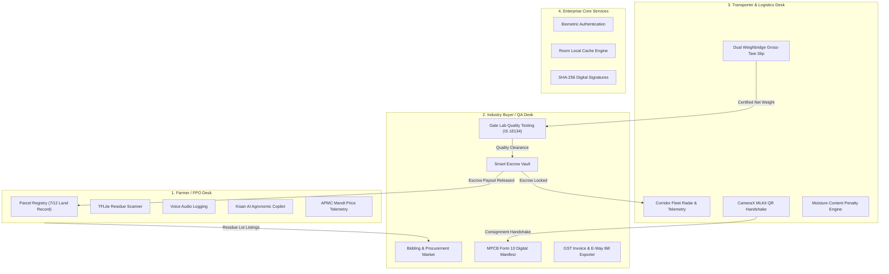
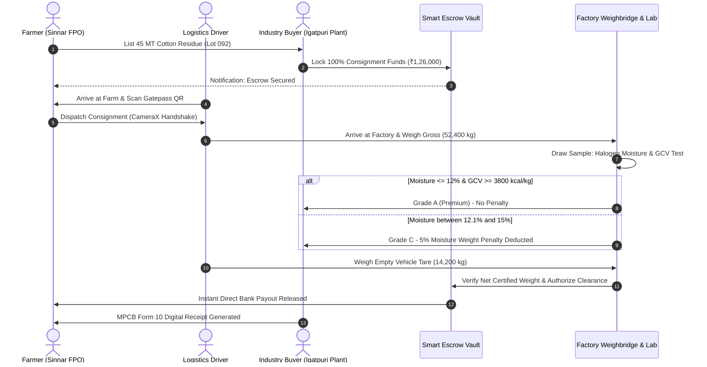

# AgriStock (WasteTrack) • Team AstraNyx

[](https://developer.android.com/)
[](https://kotlinlang.org/)
[](https://developer.android.com/jetpack/compose)
[](#system-architecture)
[](https://dagger.dev/hilt/)
[](https://developer.android.com/training/data-storage/room)
[](#mpcb-form-10-statutory-compliance)

> **AgriStock** is a multi-sided circular economy and agricultural waste monetization platform built for Maharashtra's agrarian heartland (Nashik, Sinnar, Niphad, Dindori, Igatpuri). It bridges farmers, industrial biomass buyers, logistics operators, and regulatory bodies to eliminate open-field stubble burning, streamline statutory MPCB environmental compliance, and ensure fair, escrow-protected payments.

---

## Executive Summary & Problem Landscape

In Maharashtra and Central India alone, over **28 Million Metric Tonnes** of crop residue (cotton stalks, sugarcane bagasse, soybean chaff, and wheat straw) are burned in open fields annually.

```
       [Open-Field Burning Crisis]
  ┌─────────────────────────────────────┐
  │  142 MT CO₂e avoided per 100 MT      │
  │  PM2.5 / PM10 Severe Air Pollution   │
  │  ₹15,000 / Acre NGT & MPCB Penalties │
  │  Loss of Soil Microbial Biodiversity │
  └──────────────────┬──────────────────┘
                     │  Aggravated By
                     ▼
  ┌─────────────────────────────────────┐
  │  Supply Chain Fragmentation:        │
  │  • Lack of price transparency       │
  │  • High rural transport cost        │
  │  • Fear of buyer payment defaults   │
  │  • Complex regulatory paperwork     │
  └─────────────────────────────────────┘
```

Meanwhile, thermal power stations, briquette processors, and paper mills face acute biomass supply deficits to satisfy the **Ministry of New and Renewable Energy (MNRE)** mandatory 5% to 7% biomass co-firing mandate.

**AgriStock** resolves this bottleneck through a verified 4-persona digital corridor.

---

## The 4-Persona System Architecture



---

## Role & Contributor Distribution Matrix

AgriStock was designed and delivered by **Team AstraNyx** with strict separation of concerns, domain-driven boundaries, and realistic GitFlow PR workflows:

| Team Member | Engineering Role | GitHub Profile | Core Deliverables & Shipped Features |
|:---|:---|:---|:---|
| **Sumit Borase** | Team Lead / System Architect | [`sumitborse63`](https://github.com/sumitborse63) | • App Architecture, Navigation Graph & Theme Design<br>• Biometric Authentication & Session Vault<br>• Farmer Dashboard & Crop Cycle Management<br>• TensorFlow Lite Crop Residue Classifier<br>• Farmland Parcel Registry & 7/12 Survey Tracker<br>• Kisan Conversational AI Assistant & Agronomic Copilot |
| **Kasturi Shinde** | Industry Buyer & Compliance Lead | [`KasturiShinde03`](https://github.com/KasturiShinde03) | • Buyer/Recycler Industrial Dashboard<br>• Bidding Marketplace & Auction Procurement Desk<br>• Smart Contract Escrow Order Vault<br>• MPCB Hazardous/Bio-waste Form 10 Compliance Engine<br>• GST Biomass Tax Invoice & Gatepass Manifest Exporter<br>• Gate Lab Biomass Quality (IS 18134 GCV) & Moisture Audit |
| **Harshita Thakur** | Transporter & Fleet Logistics Lead | [`Harsita-thakur`](https://github.com/Harsita-thakur) | • Transporter & Driver Telemetry Dashboard<br>• Real-time Fleet Radar & Corridor Route Simulation<br>• CameraX ML Kit Consignment QR Scanner Handshake<br>• Dual Weighbridge Gross-Tare Slip Generator<br>• Dynamic Moisture Deduction Engine ($>12\%$ threshold) |
| **Harshal Suryawanshi** | AI, Speech & Onboarding Specialist | [`harshal385`](https://github.com/harshal385) | • Multi-lingual Voice Residue Audio Logger<br>• Enterprise Onboarding Carousel with Custom Agricultural Photography<br>• Kisan AI Voice Query & Regional Dialect Support |

---

## End-to-End Escrow & Inspection Lifecycle



---

## Key Modules & Technical Implementation

### 1. Farmland Parcel Registry & 7/12 Survey Tracker
* Integrated cadastral parcel tracking (`FarmlandParcel`, `SurveyNumber`, `GatNumber`).
* Maharashtra Land Revenue Code compliance: validates agricultural land use, geo-coordinates, and annual stubble non-burning declarations before listing biomass.

### 2. CameraX & Google ML Kit QR Consignment Handshake
* Zero-latency optical gatepass scanning with fallback entry.
* Cryptographically matches `ConsignmentManifest` tokens between Farmer pickup and Factory gate arrival.

### 3. Gate Lab Quality & Moisture Deduction Engine (IS 18134)
* Proximate Analysis calculator for boiler fuel acceptance:
  * **Gross Calorific Value (GCV):** 3,400 – 4,400 kcal/kg standard.
  * **Moisture Content Analyzer:** Real-time weight deduction for moisture above the 12.0% threshold.
  * **Ash & Silica Content:** Boiler slagging prevention audits ($<5\%$).
* SHA-256 digital certificate generation with verifiable audit hashes.

### 4. MPCB Form 10 Statutory Compliance & GST Invoicing
* Generates statutory hazardous and agricultural residue consignment manifests in accordance with Maharashtra Pollution Control Board (MPCB) regulations.
* Automated HSN Code mapping (HSN 1213 cereal chaff, HSN 1404 biomass pellets, HSN 2308 bagasse) with CGST, SGST, IGST, and TCS computation.

### 5. Kisan AI Agronomic Copilot
* Embedded conversational AI agent answering farmer queries on:
  * Daily APMC mandi rates across Nashik district.
  * MPCB & NGT open burning legal penalties.
  * Moisture reduction field drying techniques.
  * Pink bollworm pest eradication through post-harvest stalk shredding.

---

## Technology Stack

```
Presentation Layer:
├── 100% Jetpack Compose (BOM 2024.02.00)
├── Material Design 3 (Dynamic Color & High-Contrast Ag-Palette)
├── Jetpack Compose Navigation
└── Compose Lifecycle & StateFlow

Domain & Architecture:
├── Clean Architecture (Presentation -> Domain -> Data)
├── Repository Pattern with Reactive Kotlin Flow
├── Unidirectional Data Flow (MVI/MVVM State Pattern)
└── Dagger Hilt 2.51 (Full Compile-Time Dependency Injection)

Data & Hardware Integration:
├── Android Room Database 2.6 with SQLite
├── CameraX 1.3 & Google ML Kit Barcode Scanning
├── AndroidX Biometrics (Fingerprint & Face Authentication)
├── Android Keystore Hardware Security
└── Coroutines & Asynchronous Workflows
```

---

## Verification & Build Instructions

### Prerequisites
* **Android Studio:** Iguana (2023.2.1) / Jellyfish or higher
* **JDK:** Version 17 (recommended: Eclipse Temurin or Azul Zulu)
* **Android SDK:** Compile SDK 34, Min SDK 24, Target SDK 34

### Building from Source

```bash
# 1. Clone the repository
git clone https://github.com/college-hack24-nov26/hack-astranyx.git
cd hack-astranyx

# 2. Compile Kotlin codebase and run KSP code generators
./gradlew compileDebugKotlin

# 3. Assemble debug APK
./gradlew assembleDebug

# 4. Install on connected physical device or AVD
adb install app/build/outputs/apk/debug/app-debug.apk
```

---

## Regulatory Alignment

> [!NOTE]
> AgriStock is mapped against the following statutory guidelines:
> * **Air (Prevention and Control of Pollution) Act, 1981** & NGT Order 118/2013 on open-field residue combustion.
> * **Maharashtra Pollution Control Board (MPCB)** Circular on Biomass Utilization for Industrial Energy.
> * **Ministry of Power & MNRE Mandate** on 5-7% co-firing of agricultural residue pellets in coal thermal power plants.
> * **SEBI BRSR (Business Responsibility and Sustainability Reporting)** Scope 3 agricultural decarbonization disclosures.

---

## Hackathon Submission Details

* **Project Name:** AgriStock (WasteTrack)
* **Team Name:** Team AstraNyx
* **Event:** Inter-College Engineering Hackathon 2026
* **Repository:** [`https://github.com/college-hack24-nov26/hack-astranyx`](https://github.com/college-hack24-nov26/hack-astranyx)
* **License:** Apache License 2.0
