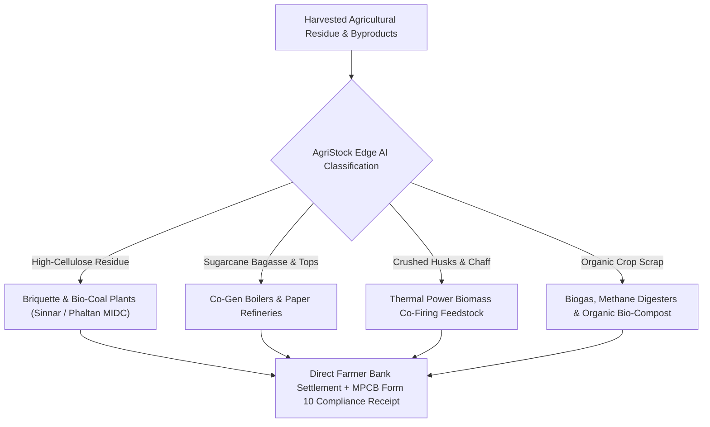
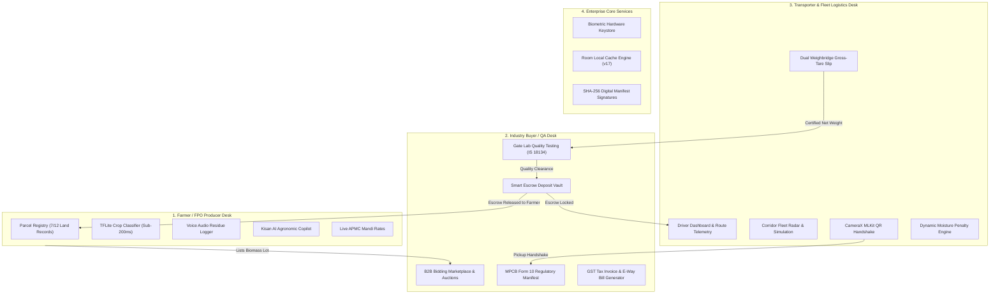
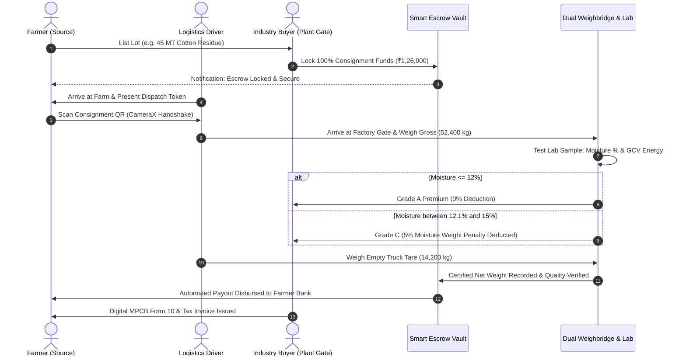

# AgriStock (Agri WasteTrack) - Team AstraNyx

[](https://www.coephaltan.edu.in/hackathon2k26.html)
[](https://www.coephaltan.edu.in/hackathon2k26.html)
[](https://www.coephaltan.edu.in)
[-3DDC84?style=for-the-badge&logo=android&logoColor=white)](https://developer.android.com/)
[](https://kotlinlang.org/)
[](https://developer.android.com/jetpack/compose)
[](#system-architecture--data-pipeline)
[](#mpcb-form-10-compliance--gst-manifests)

> **AgriStock (Agri WasteTrack)** is an Android platform and digital biomass supply chain network built for **PESCOE Hackathon 2K26** (Phaltan Education Society's College of Engineering, Phaltan). It connects farmers, industrial biomass buyers, logistics transporters, and regulatory bodies across Maharashtra (Satara, Phaltan, Nashik, Sinnar, Niphad) to replace open-field crop residue burning with commercial biomass trade, streamline MPCB Form 10 compliance manifests, enforce dual-weighbridge anti-fraud verification, and automate escrow-secured farmer payments.

---

## Table of Contents

1. [Problem Statement & Regional Context](#problem-statement--regional-context)
2. [Circular Biomass Supply Chain](#circular-biomass-supply-chain)
3. [4-Persona Architecture & System Workflows](#4-persona-architecture--system-workflows)
4. [Contributor Distribution Matrix (Team AstraNyx)](#contributor-distribution-matrix-team-astranyx)
5. [3-Way Handshake Dispatch & Weighbridge Verification](#3-way-handshake-dispatch--weighbridge-verification)
6. [Gate Lab Biomass Quality & Moisture Deduction Engine (IS 18134)](#gate-lab-biomass-quality--moisture-deduction-engine-is-18134)
7. [MPCB Form 10 Compliance & GST Manifests](#mpcb-form-10-compliance--gst-manifests)
8. [Edge AI Computer Vision & Kisan Conversational Copilot](#edge-ai-computer-vision--kisan-conversational-copilot)
9. [Farmland Parcel Registry & 7/12 Land Records](#farmland-parcel-registry--712-land-records)
10. [System Architecture & Data Pipeline](#system-architecture--data-pipeline)
11. [API & JSON Data Contract Specifications](#api--json-data-contract-specifications)
12. [Technology Stack & Core Libraries](#technology-stack--core-libraries)
13. [Verification & Build Instructions](#verification--build-instructions)
14. [Hackathon Submission & Details](#hackathon-submission--details)

---

## Problem Statement & Regional Context

In Maharashtra (spanning the sugarcane belt of Phaltan and Satara, and the cotton and onion regions of Nashik and Ahmednagar), over 28 million metric tonnes of agricultural crop residue are generated each year:

```
┌────────────────────────────────────────┐        ┌────────────────────────────────────────┐
│      Rural Supply Chain Bottlenecks    │        │       Ecological & Economic Impact     │
├────────────────────────────────────────┤        ├────────────────────────────────────────┤
│ • Stubble burning & post-harvest loss  │  ───►  │ • 142 MT CO₂e lost per 100 MT burned   │
│ • Middleman price suppression          │        │ • Up to ₹15,000/acre MPCB/NGT fines    │
│ • Transit divergence & weighbridge gaps│        │ • Acute boiler feedstock deficits      │
│ • Manual paper regulatory filings      │        │ • Payment default risks for farmers    │
└────────────────────────────────────────┘        └────────────────────────────────────────┘
```

1. **Crop Residue Burning**: Post-harvest cotton stalks, wheat chaff, and uncrushed bagasse are burned in fields due to collection and transport costs, causing localized air quality deterioration and attracting statutory penalties up to ₹15,000 per acre under the Air (Prevention and Control of Pollution) Act.
2. **Industrial Fuel Deficits**: Thermal power boilers, paper mills, and briquette manufacturers in state industrial corridors require standardized agricultural biomass to satisfy the Ministry of New and Renewable Energy (MNRE) 5% to 7% biomass co-firing mandate.
3. **Logistics & Quality Discrepancies**: Dispatched biomass consignments frequently encounter moisture-related weight variations, unverified weighbridge slips, and high ash or silica contamination.
4. **Payment Risk**: Smallholder farmers face delayed disbursements and payment insecurity when dealing with distant corporate buyers.

**AgriStock** provides an end-to-end transactional system powered by on-device computer vision, automated escrow settlements, dual weighbridge validation, and statutory compliance automation.

---

## Circular Biomass Supply Chain

Agricultural residue is categorized and routed to industrial conversion streams based on physical and chemical properties:



* **Cotton Stalk Residue (Nashik/Sinnar)**: Gross Calorific Value (GCV) >= 3,900 kcal/kg, substituting industrial coal.
* **Sugarcane Bagasse (Phaltan/Satara)**: High-fiber biomass for co-generation boilers and biodegradable packaging.
* **Soybean Chaff & Wheat Straw**: Raw substrate for compressed biomass briquettes, animal fodder pellets, and bio-fertilizer.

---

## 4-Persona Architecture & System Workflows

AgriStock enforces role-based access across 4 operational modules:



---

## Contributor Distribution Matrix (Team AstraNyx)

AgriStock was built by Team AstraNyx with domain-driven package boundaries and GitFlow pull request workflows:

| Contributor | Role | GitHub Profile | Core Deliverables & Responsibilities |
|:---|:---|:---|:---|
| **Sumit Borase** | Team Lead / System Architect | [`@sumitborse63`](https://github.com/sumitborse63) | - Architecture, Theme & Navigation Graph<br>- Biometric Authentication & Session Keystore<br>- Farmer Dashboard & Crop Cycle Management<br>- TensorFlow Lite MobileNet Residue Classifier<br>- Farmland Parcel Registry & 7/12 Survey Tracker<br>- Kisan Conversational AI Assistant & Agronomic Copilot |
| **Kasturi Shinde** | Industry Buyer & Compliance Lead | [`@KasturiShinde03`](https://github.com/KasturiShinde03) | - Industrial Buyer & Recycler Console<br>- B2B Bidding Marketplace & Auction Procurement Desk<br>- Smart Contract Escrow Order Vault<br>- MPCB Hazardous/Bio-waste Form 10 Compliance Engine<br>- GST Biomass Tax Invoice & Gatepass Manifest Exporter<br>- Gate Lab Biomass Quality (IS 18134 GCV) & Moisture Audit |
| **Harshita Thakur** | Transporter & Fleet Logistics Lead | [`@Harsita-thakur`](https://github.com/Harsita-thakur) | - Transporter & Driver Telemetry Dashboard<br>- Corridor Fleet Radar & Real-Time Route Simulation<br>- CameraX ML Kit Optical QR Handshake Scanner<br>- Dual Weighbridge Gross-Tare Slip Generator<br>- Moisture Content Deduction Engine (>12% threshold) |
| **Harshal Suryawanshi** | AI, Speech & Onboarding Specialist | [`@harshal385`](https://github.com/harshal385) | - Multilingual Voice Residue Audio Logger<br>- Onboarding Carousel with Custom Agricultural Photography<br>- Regional Dialect Support (Marathi/Hindi) |

---

## 3-Way Handshake Dispatch & Weighbridge Verification

To eliminate transit diversion, scrap ballast padding, and unverified drop-offs:



---

## Gate Lab Biomass Quality & Moisture Deduction Engine (IS 18134)

When biomass consignments reach the factory gate, proximate analysis is conducted before escrow release:

* **Gross Calorific Value (GCV)**: Energy rating measured in kcal/kg (Benchmark: 3,400 to 4,400 kcal/kg).
* **Moisture Content Analyzer**: Real-time deduction algorithm:
  * **<= 12.0% (Grade A Premium)**: 0% penalty, full payout released.
  * **12.1% to 14.0% (Grade B Standard)**: 2% moisture adjustment.
  * **14.1% to 16.0% (Grade C Penalty)**: 5% weight deduction applied to escrow payout.
  * **> 16.0% or Ash > 8.0%**: Consignment rejected to protect industrial boilers from clinkering.
* **Digital Audit Stamp**: Each certificate is sealed with a unique SHA-256 cryptographic digest.

---

## MPCB Form 10 Compliance & GST Manifests

* **Maharashtra Pollution Control Board (MPCB) Form 10 Manifest**: Generates transit manifests required under the Hazardous and Other Wastes (Management and Transboundary Movement) Rules.
* **HSN Code Tax Mapping**:
  * **HSN 1213**: Cereal straw and husks, unprepared.
  * **HSN 1404**: Vegetable materials used primarily as biomass fuel.
  * **HSN 2308**: Sugarcane bagasse and agro-industrial waste.
* **Vector PDF Engine**: Renders A4 regulatory certificates and E-Way bill receipts natively using Android `PdfDocument`.

---

## Edge AI Computer Vision & Kisan Conversational Copilot

### 1. Multi-Modal Edge AI Scanner (`CropClassifier.kt`)
* **Sub-200ms Inference**: Runs offline on Android field hardware using quantized TensorFlow Lite models.
* **Automated Waste Segregation**: Distinguishes dry fibrous biomass from wet organic spoilage and calculates degradation index and shelf life.

### 2. Kisan AI Agronomic Copilot (`AgentScreen.kt` & `AgentViewModel.kt`)
* Embedded agronomic intelligence answering farmer questions:
  * Daily APMC mandi rates across Nashik, Sinnar, and Phaltan markets.
  * MPCB and NGT open burning legal penalties and alternative subsidies.
  * Field sun-drying schedules to achieve <= 12% moisture threshold.
  * Pink bollworm eradication protocols via post-harvest stalk shredding.

---

## Farmland Parcel Registry & 7/12 Land Records

* **Cadastral Farm Parcel Mapping**: Registers agricultural parcels with Gat Numbers, Survey Numbers, and GPS polygon coordinates.
* **7/12 Maharashtra Land Record Integration**: Validates land ownership, crop cultivation history, and legal non-burning compliance affidavits.

---

## System Architecture & Data Pipeline

```
┌─────────────────────────────────────────────────────────────────┐
│                      Presentation Layer                         │
│   Jetpack Compose UI • Material 3 Theming • CameraX & Voice     │
│                            │                                    │
│                     StateFlow / State                           │
│                            ▼                                    │
│                 Architecture ViewModels                         │
│   (FarmerDashboardVM, RecyclerVM, DriverVM, AgentVM, etc.)      │
└────────────────────────────┬────────────────────────────────────┘
                             │
┌────────────────────────────▼────────────────────────────────────┐
│                        Domain Layer                             │
│   Domain Models: CropCycle, Farm, Listing, Order, BiomassReport │
│   Repository Interfaces: IAuthRepo, ICropRepo, IMarketRepo      │
└────────────────────────────┬────────────────────────────────────┘
                             │
┌────────────────────────────▼────────────────────────────────────┐
│                         Data Layer                              │
│   Room Local SQLite DB (v17) ──► WorkManager Background Sync    │
│   TFLite Neural Classifier   ──► ML Kit Optical Barcode Scanner │
│   AndroidX Biometric Keystore──► Native PDF Vector Exporter     │
└─────────────────────────────────────────────────────────────────┘
```

---

## API & JSON Data Contract Specifications

AgriStock uses typed JSON data contracts for inter-service communication, hardware handshakes, and statutory reporting:

### 1. Consignment Dispatch Handshake (`POST /api/v1/consignments/dispatch`)

```json
{
  "dispatchId": "DSP-MH-2026-9142",
  "orderId": "ORD-2026-8812",
  "farmerId": "USR-FARMER-NSK-042",
  "farmerGstin": "27AABCU9603R1ZM",
  "transporterId": "TRP-MH-2026-5510",
  "vehicleRegistrationNumber": "MH-15-EG-4921",
  "driverLicense": "MH-15-2018-009142",
  "commodity": {
    "hsnCode": "1404",
    "cropName": "Cotton Stalk Biomass",
    "form": "BALED_RECTANGULAR",
    "declaredWeightMt": 45.0,
    "sourceFarmParcelId": "FARM-SN-114-GAT-82"
  },
  "pickupLocation": {
    "district": "Nashik",
    "taluka": "Sinnar",
    "village": "Musalgaon",
    "latitude": 19.8452,
    "longitude": 73.9921
  },
  "destinationPlant": {
    "buyerId": "BYR-IND-IGP-018",
    "plantName": "Mahindra Bio-Energy Refineries",
    "deliveryPincode": "422403"
  },
  "handshakeVerificationToken": "SHA256:d8a9f4c2e1b0d7e6f9a8b1c2d3e4f5a6b7c8d9e0f",
  "dispatchTimestampMillis": 1762208400000,
  "status": "IN_TRANSIT"
}
```

### 2. Dual Weighbridge Gross-Tare Slip (`POST /api/v1/weighbridge/slip`)

```json
{
  "slipNumber": "WB-NSK-2026-0819",
  "orderId": "ORD-2026-8812",
  "vehicleNumber": "MH-15-EG-4921",
  "weighbridgeOperatorId": "WB-OP-7712",
  "grossWeightKg": 52400.0,
  "tareWeightKg": 14200.0,
  "measuredNetWeightKg": 38200.0,
  "moisturePenaltyDeductionKg": 1910.0,
  "finalCertifiedNetWeightKg": 36290.0,
  "tolerances": {
    "declaredWeightKg": 45000.0,
    "variancePercentage": -15.1,
    "status": "AUDITED_AND_CLEARED"
  },
  "grossWeighTimestampMillis": 1762214400000,
  "tareWeighTimestampMillis": 1762220400000,
  "digitalSignature": "RSA-SHA256:4a8b1c2d3e4f5a6b7c8d9e0f1a2b3c4d"
}
```

### 3. Gate Lab Proximate Analysis & Quality Certificate (IS 18134) (`POST /api/v1/quality/proximate-analysis`)

```json
{
  "certificateNumber": "QLAB-NSK-2026-0819",
  "orderId": "ORD-2026-8812",
  "lotNumber": "LOT-COTTON-092",
  "technician": "Kasturi Shinde (QA & Boiler Chemist)",
  "standardCompliance": "IS 18134-1 / ASTM D5865-19",
  "proximateAnalysis": {
    "grossCalorificValueKcalKg": 3980.0,
    "moisturePercentage": 14.6,
    "ashPercentage": 4.1,
    "volatileMatterPercentage": 69.2,
    "fixedCarbonPercentage": 15.9
  },
  "commercialAssessment": {
    "grade": "GRADE_C_PENALTY",
    "moistureThresholdPercentage": 12.0,
    "excessMoisturePercentage": 2.6,
    "penaltyDeductionPercentage": 5.0,
    "grossEscrowAmountInr": 126000.0,
    "penaltyDeductionAmountInr": 6300.0,
    "netEscrowClearanceInr": 119700.0
  },
  "escrowClearanceStatus": "AUTHORIZED_FOR_RELEASE",
  "sha256AuditHash": "SHA256:8f9a4c2e1b0d7e6f9a8b1c2d3e4f5a6b7c8d9e0f"
}
```

### 4. MPCB Form 10 Statutory Consignment Manifest (`GET /api/v1/compliance/mpcb-form10/{id}`)

```json
{
  "manifestId": "MPCB-F10-NSK-2026-9142",
  "regulation": "Maharashtra Pollution Control Board (Hazardous & Other Wastes Management Rules)",
  "sender": {
    "name": "Sinnar Agro FPO Cooperative Ltd",
    "address": "Gat No 82, Musalgaon Industrial Road, Sinnar, Nashik",
    "mpcbConsentNumber": "MPCB/RO-NSK/CONSENT/2025/1109"
  },
  "receiver": {
    "name": "Igatpuri Bio-Energy Power Project",
    "address": "Plot C-14, MIDC Igatpuri, Nashik",
    "mpcbConsentNumber": "MPCB/RO-NSK/CONSENT/2024/0984"
  },
  "wasteDetails": {
    "category": "CROP_RESIDUE_BIOMASS",
    "physicalState": "SOLID_BALED",
    "totalQuantityMt": 36.29,
    "co2eAvoidedMt": 51.53
  },
  "transporterHandshakeToken": "SHA256:7b6c5d4e3f2a1b0c9d8e7f6a5b4c3d2e",
  "status": "DELIVERED_AND_FILED"
}
```

### 5. Standardized Precipitation Index (SPI) & Agroplan Telemetry (`GET /api/v1/weather/agroplan`)

```json
{
  "location": {
    "district": "Satara",
    "taluka": "Phaltan",
    "coordinates": { "lat": 17.9833, "lon": 74.4333 }
  },
  "weatherObservation": {
    "temperatureCelsius": 31.4,
    "humidityPercentage": 38.0,
    "windSpeedKmH": 11.2,
    "precipitationProbability": 0.05
  },
  "soilProductivityMetrics": {
    "soilClassification": "Deep Black Cotton Clay (Vertisol)",
    "soilMoistureIndex": 0.42,
    "standardizedPrecipitationIndex": {
      "spi1Month": -0.68,
      "spiClassification": "MILD_DRY_PHASE",
      "recommendedFieldDryingHours": 48
    }
  },
  "agroplanAdvisory": {
    "cropResidueAdvice": "Optimal conditions for outdoor sun-drying. Sugarcane tops and bagasse will reach target 11% moisture within 48 hours.",
    "irrigationRecommendation": "Reduce surface drip by 15% to maintain soil aeration.",
    "pinkBollwormAlert": "Low risk. Complete post-harvest shredding within 10 days."
  }
}
```

---

## Technology Stack & Core Libraries

| Layer / Domain | Library / Framework | Version | Purpose & Implementation |
|:---|:---|:---|:---|
| **Language & Tooling** | Kotlin | `2.0.0` | Modern type-safe development with Kotlin 2.0 Compose compiler |
| **Build System** | Android Gradle Plugin (AGP) | `8.6.0` | Build orchestration with KSP (`2.0.0-1.0.24`) |
| **Target SDKs** | Compile & Target SDK 35 | `API 35` (Android 15) | Min SDK 24 (Android 7.0+) for 95%+ rural device coverage |
| **UI System** | Jetpack Compose (BOM) | `2024.06.00` | Declarative UI with Material Design 3 (`1.2.1`) dynamic color |
| **Icons & Fonts** | Material Icons Extended & Google Fonts | `1.7.8` | High-contrast agritech icons & Poppins typography |
| **Navigation** | Navigation Compose | `2.9.0` | Single-activity route orchestrator across all 4 personas |
| **Architecture & DI** | Dagger Hilt & Hilt Navigation | `2.51.1` / `1.2.0` | Compile-time dependency injection across all `@HiltViewModel` classes |
| **Local Relational DB** | Android Room (KSP) | `2.7.1` | Offline-first reactive local database with DAOs & TypeConverters |
| **Preferences Store** | AndroidX DataStore | `1.1.7` | Asynchronous session vault & role resolver |
| **Edge AI & CV** | TensorFlow Lite & Support | `2.16.1` / `0.4.4` | Sub-200ms on-device crop residue classification & moisture estimation |
| **Optical & OCR ML** | Google ML Kit Vision | `17.3.0` / `16.0.1` | Optical Barcode QR scanning (`17.3.0`) & Text OCR (`16.0.1`) |
| **QR Code Engine** | ZXing Core | `3.5.3` | Dynamic SHA-256 cryptographic gatepass QR generation |
| **Camera Pipeline** | AndroidX CameraX | `1.5.0` | Camera2 preview, image capture & frame analysis |
| **Networking & HTTP** | Retrofit 2 & OkHttp 3 | `2.11.0` / `4.12.0` | REST API communication with logging interceptors and Gson converter |
| **Background Sync** | AndroidX WorkManager & Hilt Work | `2.10.1` / `1.2.0` | Background task queue for offline-first sync workers |
| **Reactive Concurrency**| Kotlin Coroutines & Flow | `1.10.2` | Structured concurrency, `StateFlow`, and reactive UI pipelines |
| **Hardware Biometrics**| AndroidX Biometric | `1.1.0` | Fingerprint & Face Unlock hardware security for Escrow release |
| **Geospatial & GPS** | Play Services Maps & Maps Compose | `19.0.0` / `6.1.2` | Corridor fleet radar, route simulation, and live map rendering |
| **Location Services** | Play Services Location | `21.3.0` | High-accuracy GPS coordinates for driver consignment handshakes |
| **Payments & Escrow** | Razorpay Checkout SDK & UPI | `1.6.40` | Smart Escrow transaction simulation and native UPI deep link intents |
| **Image Loading** | Coil Compose | `2.6.0` | Asynchronous image loading with memory & disk caching |
| **Cloud Synchronization**| Firebase BOM (Firestore/Auth/Storage)| `33.12.0` | Multi-device cloud sync, authentication, and remote telemetry |
| **Document Engine** | Android Native `PdfDocument` | Built-in | Vector A4 MPCB Form 10 manifests & GST tax invoice export |

---

## Verification & Build Instructions

### 1. Development Environment
* **Android Studio:** Iguana (2023.2.1), Jellyfish, Koala, or Ladybug (2024.2+)
* **Java Development Kit (JDK):** Version 17 (Eclipse Temurin 17 or Azul Zulu 17)
* **Android SDK Build Tools:** 35.0.0 (API Level 35)
* **Compatibility:**
  * `minSdk`: **24** (Android 7.0+)
  * `targetSdk`: **35** (Android 15)
  * `compileSdk`: **35**

### 2. Configuration (`local.properties`)
AgriStock operates with default fallbacks out of the box. All external services function without configuring external API accounts.

Optional keys in `local.properties`:

```properties
sdk.dir=C\:\\Users\\<YourUsername>\\AppData\\Local\\Android\\Sdk
MAPS_API_KEY=your_google_maps_api_key
GROQ_API_KEY=your_groq_api_key
RAZORPAY_KEY_ID=rzp_test_51AgriStockEscrow
ESCROW_UPI_ID=agristock.escrow@upi
ESCROW_PAYEE_NAME=AgriStock Escrow Vault
```

### 3. Required Runtime Permissions
* **`android.permission.CAMERA`**: CameraX & ML Kit optical QR handshake and crop classification.
* **`android.permission.RECORD_AUDIO`**: Multilingual voice residue logging assistant.
* **`android.permission.ACCESS_FINE_LOCATION`**: Corridor fleet radar, live ETA calculation, and nearby buyer discovery.
* **`android.permission.POST_NOTIFICATIONS`**: Dispatch milestones and escrow release alerts.

### 4. Build & Run Commands

```bash
# Clone the repository
git clone https://github.com/college-hack24-nov26/hack-astranyx.git
cd hack-astranyx

# Compile Kotlin Source & Run KSP
./gradlew compileDebugKotlin

# Build Debug APK
./gradlew assembleDebug

# Install APK to Device or Emulator
adb install -r app/build/outputs/apk/debug/app-debug.apk

# Launch Application
adb shell am start -n com.sktech.wastetrack/.MainActivity
```

### 5. Persona Walkthrough
* **Farmer Workflow**: Open Farmer Dashboard -> View 7/12 Land records, tap "Ask Kisan AI Assistant" for mandi rates, and tap "Log Crop" for camera classification.
* **Industry Buyer Workflow**: Open Recycler Dashboard -> Inspect Escrow Vault, tap "Gate Lab Quality & Moisture Audit" to test sample GCV/moisture and generate the SHA-256 certificate, and tap "GST Invoices" for MPCB Form 10 manifests.
* **Transporter Workflow**: Open Driver Dashboard -> View corridor GPS telemetry, test CameraX QR Scanner, and generate Weighbridge Gross-Tare Slips.

---

## Hackathon Submission & Details

* **Hackathon:** [PESCOE Hackathon 2K26](https://www.coephaltan.edu.in/hackathon2k26.html)
* **Host Institute:** Phaltan Education Society's College of Engineering, Phaltan (PESCOE)
* **Team Name:** Team AstraNyx
* **Institution:** K. K. Wagh Institute of Engineering Education & Research, Nashik (Savitribai Phule Pune University)
* **Target Agricultural Corridors:** Satara-Phaltan Sugar Belt, Nashik-Sinnar Cotton & Onion Cluster, Niphad Bio-Energy Basin
* **License:** Apache License 2.0

---

<div align="center">
  <sub>Made with ❤️ by Team AstraNyx for PESCOE Hackathon 2K26</sub>
</div>
